# Projects and dependencies analysis

This document provides a comprehensive overview of the projects and their dependencies in the context of upgrading to .NETCoreApp,Version=v10.0.

## Table of Contents

- [Executive Summary](#executive-Summary)
  - [Highlevel Metrics](#highlevel-metrics)
  - [Projects Compatibility](#projects-compatibility)
  - [Package Compatibility](#package-compatibility)
  - [API Compatibility](#api-compatibility)
- [Aggregate NuGet packages details](#aggregate-nuget-packages-details)
- [Top API Migration Challenges](#top-api-migration-challenges)
  - [Technologies and Features](#technologies-and-features)
  - [Most Frequent API Issues](#most-frequent-api-issues)
- [Projects Relationship Graph](#projects-relationship-graph)
- [Project Details](#project-details)

  - [runtime\VMProtect.Runtime\Tests\UnitTestProject\UnitTestProject.csproj](#runtimevmprotectruntimetestsunittestprojectunittestprojectcsproj)
  - [runtime\VMProtect.Runtime\VMProtect.Netcore.csproj](#runtimevmprotectruntimevmprotectnetcorecsproj)
  - [runtime\VMProtect.Runtime\VMProtect.Runtime.csproj](#runtimevmprotectruntimevmprotectruntimecsproj)
  - [sdk\VMProtect.SDK\VMProtect.SDK.csproj](#sdkvmprotectsdkvmprotectsdkcsproj)
  - [utils\ipn_tool\ipn_tool.csproj](#utilsipn_toolipn_toolcsproj)
  - [vcproj\core.vcxproj](#vcprojcorevcxproj)
  - [vcproj\gtest.vcxproj](#vcprojgtestvcxproj)
  - [vcproj\invariant_core.vcxproj](#vcprojinvariant_corevcxproj)
  - [vcproj\MiniDumpFixer.vcxproj](#vcprojminidumpfixervcxproj)
  - [vcproj\ShellExt.vcxproj](#vcprojshellextvcxproj)
  - [vcproj\unit-tests.vcxproj](#vcprojunit-testsvcxproj)
  - [vcproj\VMProtect.vcxproj](#vcprojvmprotectvcxproj)
  - [vcproj\VMProtectCon.vcxproj](#vcprojvmprotectconvcxproj)
  - [vcproj\VMProtectSDK.vcxproj](#vcprojvmprotectsdkvcxproj)
  - [vcproj\win_runtime.Tests.vcxproj](#vcprojwin_runtimetestsvcxproj)
  - [vcproj\win_runtime.vcxproj](#vcprojwin_runtimevcxproj)

## Executive Summary

### Highlevel Metrics

| Metric | Count | Status |
| :--- | :---: | :--- |
| Total Projects | 16 | 5 require upgrade |
| Total NuGet Packages | 0 | All compatible |
| Total Code Files | 71 |  |
| Total Code Files with Incidents | 20 |  |
| Total Lines of Code | 54789 |  |
| Total Number of Issues | 123 |  |
| Estimated LOC to modify | 114+ | at least 0.2% of codebase |

### Projects Compatibility

| Project | Target Framework | Difficulty | Package Issues | API Issues | Est. LOC Impact | Description |
| :--- | :---: | :---: | :---: | :---: | :---: | :--- |
| [runtime\VMProtect.Runtime\Tests\UnitTestProject\UnitTestProject.csproj](#runtimevmprotectruntimetestsunittestprojectunittestprojectcsproj) | net48 | 🟢 Low | 0 | 23 | 23+ | ClassicWinForms, Sdk Style = False |
| [runtime\VMProtect.Runtime\VMProtect.Netcore.csproj](#runtimevmprotectruntimevmprotectnetcorecsproj) | netstandard2.1;netcoreapp3.0;net20;net40 | 🟢 Low | 0 | 6 | 6+ | ClassLibrary, Sdk Style = True |
| [runtime\VMProtect.Runtime\VMProtect.Runtime.csproj](#runtimevmprotectruntimevmprotectruntimecsproj) | net48 | 🟢 Low | 0 | 6 | 6+ | ClassicWinForms, Sdk Style = False |
| [sdk\VMProtect.SDK\VMProtect.SDK.csproj](#sdkvmprotectsdkvmprotectsdkcsproj) | net48 | 🟢 Low | 0 | 0 |  | ClassicClassLibrary, Sdk Style = False |
| [utils\ipn_tool\ipn_tool.csproj](#utilsipn_toolipn_toolcsproj) | net48 | 🟢 Low | 0 | 79 | 79+ | ClassicDotNetApp, Sdk Style = False |
| [vcproj\core.vcxproj](#vcprojcorevcxproj) |  | ✅ None | 0 | 0 |  | ClassicDotNetApp, Sdk Style = False |
| [vcproj\gtest.vcxproj](#vcprojgtestvcxproj) |  | ✅ None | 0 | 0 |  | ClassicDotNetApp, Sdk Style = False |
| [vcproj\invariant_core.vcxproj](#vcprojinvariant_corevcxproj) |  | ✅ None | 0 | 0 |  | ClassicDotNetApp, Sdk Style = False |
| [vcproj\MiniDumpFixer.vcxproj](#vcprojminidumpfixervcxproj) |  | ✅ None | 0 | 0 |  | ClassicDotNetApp, Sdk Style = False |
| [vcproj\ShellExt.vcxproj](#vcprojshellextvcxproj) |  | ✅ None | 0 | 0 |  | ClassicClassLibrary, Sdk Style = False |
| [vcproj\unit-tests.vcxproj](#vcprojunit-testsvcxproj) |  | ✅ None | 0 | 0 |  | ClassicDotNetApp, Sdk Style = False |
| [vcproj\VMProtect.vcxproj](#vcprojvmprotectvcxproj) |  | ✅ None | 0 | 0 |  | ClassicDotNetApp, Sdk Style = False |
| [vcproj\VMProtectCon.vcxproj](#vcprojvmprotectconvcxproj) |  | ✅ None | 0 | 0 |  | ClassicDotNetApp, Sdk Style = False |
| [vcproj\VMProtectSDK.vcxproj](#vcprojvmprotectsdkvcxproj) |  | ✅ None | 0 | 0 |  | ClassicClassLibrary, Sdk Style = False |
| [vcproj\win_runtime.Tests.vcxproj](#vcprojwin_runtimetestsvcxproj) |  | ✅ None | 0 | 0 |  | ClassicDotNetApp, Sdk Style = False |
| [vcproj\win_runtime.vcxproj](#vcprojwin_runtimevcxproj) |  | ✅ None | 0 | 0 |  | ClassicClassLibrary, Sdk Style = False |

### Package Compatibility

| Status | Count | Percentage |
| :--- | :---: | :---: |
| ✅ Compatible | 0 | 0.0% |
| ⚠️ Incompatible | 0 | 0.0% |
| 🔄 Upgrade Recommended | 0 | 0.0% |
| ***Total NuGet Packages*** | ***0*** | ***100%*** |

### API Compatibility

| Category | Count | Impact |
| :--- | :---: | :--- |
| 🔴 Binary Incompatible | 0 | High - Require code changes |
| 🟡 Source Incompatible | 104 | Medium - Needs re-compilation and potential conflicting API error fixing |
| 🔵 Behavioral change | 10 | Low - Behavioral changes that may require testing at runtime |
| ✅ Compatible | 27801 |  |
| ***Total APIs Analyzed*** | ***27915*** |  |

## Aggregate NuGet packages details

| Package | Current Version | Suggested Version | Projects | Description |
| :--- | :---: | :---: | :--- | :--- |

## Top API Migration Challenges

### Technologies and Features

| Technology | Issues | Percentage | Migration Path |
| :--- | :---: | :---: | :--- |
| Legacy Cryptography | 13 | 11.4% | Obsolete or insecure cryptographic algorithms that have been deprecated for security reasons. These algorithms are no longer considered secure by modern standards. Migrate to modern cryptographic APIs using secure algorithms. |

### Most Frequent API Issues

| API | Count | Percentage | Category |
| :--- | :---: | :---: | :--- |
| T:System.Security.Cryptography.SHA1Managed | 13 | 11.4% | Source Incompatible |
| M:System.Data.SqlClient.SqlDataReader.GetString(System.Int32) | 10 | 8.8% | Source Incompatible |
| T:System.Data.SqlClient.SqlParameterCollection | 7 | 6.1% | Source Incompatible |
| P:System.Data.SqlClient.SqlCommand.Parameters | 7 | 6.1% | Source Incompatible |
| T:System.Data.SqlClient.SqlParameter | 7 | 6.1% | Source Incompatible |
| M:System.Data.SqlClient.SqlParameterCollection.AddWithValue(System.String,System.Object) | 7 | 6.1% | Source Incompatible |
| T:System.Data.SqlClient.SqlConnection | 6 | 5.3% | Source Incompatible |
| M:System.IO.BinaryReader.ReadString | 5 | 4.4% | Behavioral Change |
| M:System.Data.SqlClient.SqlConnection.Open | 4 | 3.5% | Source Incompatible |
| P:System.Data.SqlClient.SqlCommand.CommandTimeout | 4 | 3.5% | Source Incompatible |
| P:System.Data.SqlClient.SqlCommand.CommandType | 4 | 3.5% | Source Incompatible |
| T:System.Data.SqlClient.SqlCommand | 4 | 3.5% | Source Incompatible |
| M:System.Data.SqlClient.SqlCommand.#ctor(System.String,System.Data.SqlClient.SqlConnection) | 4 | 3.5% | Source Incompatible |
| P:System.Environment.OSVersion | 4 | 3.5% | Behavioral Change |
| T:System.Runtime.Serialization.FormatterServices | 4 | 3.5% | Source Incompatible |
| M:System.Data.SqlClient.SqlDataReader.Read | 3 | 2.6% | Source Incompatible |
| T:System.Data.SqlClient.SqlDataReader | 3 | 2.6% | Source Incompatible |
| M:System.Data.SqlClient.SqlCommand.ExecuteReader | 3 | 2.6% | Source Incompatible |
| M:System.Data.SqlClient.SqlDataReader.GetInt32(System.Int32) | 2 | 1.8% | Source Incompatible |
| T:System.Runtime.Serialization.StreamingContextStates | 2 | 1.8% | Source Incompatible |
| M:System.Data.SqlClient.SqlConnection.#ctor(System.String) | 1 | 0.9% | Source Incompatible |
| M:System.Data.SqlClient.SqlDataReader.GetDateTime(System.Int32) | 1 | 0.9% | Source Incompatible |
| M:System.Data.SqlClient.SqlCommand.ExecuteScalar | 1 | 0.9% | Source Incompatible |
| M:System.Exception.GetObjectData(System.Runtime.Serialization.SerializationInfo,System.Runtime.Serialization.StreamingContext) | 1 | 0.9% | Source Incompatible |
| T:System.Runtime.Serialization.FormatterConverter | 1 | 0.9% | Source Incompatible |
| M:System.Runtime.Serialization.SerializationInfo.#ctor(System.Type,System.Runtime.Serialization.IFormatterConverter) | 1 | 0.9% | Source Incompatible |
| T:System.Runtime.Serialization.ObjectManager | 1 | 0.9% | Source Incompatible |
| M:System.Runtime.Serialization.StreamingContext.#ctor(System.Runtime.Serialization.StreamingContextStates) | 1 | 0.9% | Source Incompatible |
| P:System.Type.IsSerializable | 1 | 0.9% | Source Incompatible |
| M:System.Type.MakeArrayType | 1 | 0.9% | Behavioral Change |
| T:System.Runtime.ExceptionServices.HandleProcessCorruptedStateExceptionsAttribute | 1 | 0.9% | Source Incompatible |

## Projects Relationship Graph

Legend:
📦 SDK-style project
⚙️ Classic project

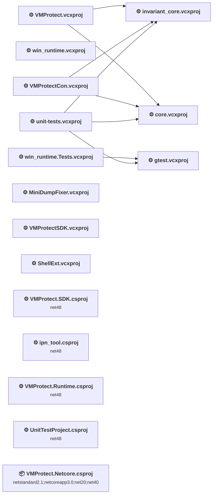

## Project Details

### runtime\VMProtect.Runtime\Tests\UnitTestProject\UnitTestProject.csproj

#### Project Info

- **Current Target Framework:** net48
- **Proposed Target Framework:** net10.0-windows
- **SDK-style**: False
- **Project Kind:** ClassicWinForms
- **Dependencies**: 0
- **Dependants**: 0
- **Number of Files**: 36
- **Number of Files with Incidents**: 9
- **Lines of Code**: 28837
- **Estimated LOC to modify**: 23+ (at least 0.1% of the project)

#### Dependency Graph

Legend:
📦 SDK-style project
⚙️ Classic project

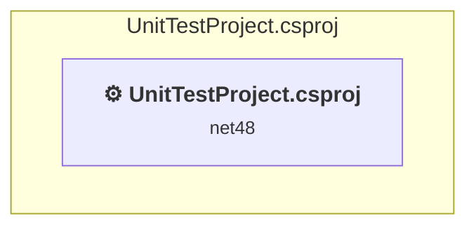

### API Compatibility

| Category | Count | Impact |
| :--- | :---: | :--- |
| 🔴 Binary Incompatible | 0 | High - Require code changes |
| 🟡 Source Incompatible | 16 | Medium - Needs re-compilation and potential conflicting API error fixing |
| 🔵 Behavioral change | 7 | Low - Behavioral changes that may require testing at runtime |
| ✅ Compatible | 16478 |  |
| ***Total APIs Analyzed*** | ***16501*** |  |

#### Project Technologies and Features

| Technology | Issues | Percentage | Migration Path |
| :--- | :---: | :---: | :--- |
| Legacy Cryptography | 5 | 21.7% | Obsolete or insecure cryptographic algorithms that have been deprecated for security reasons. These algorithms are no longer considered secure by modern standards. Migrate to modern cryptographic APIs using secure algorithms. |

### runtime\VMProtect.Runtime\VMProtect.Netcore.csproj

#### Project Info

- **Current Target Framework:** netstandard2.1;netcoreapp3.0;net20;net40
- **Proposed Target Framework:** netstandard2.1;netcoreapp3.0;net20;net40;net10.0
- **SDK-style**: True
- **Project Kind:** ClassLibrary
- **Dependencies**: 0
- **Dependants**: 0
- **Number of Files**: 14
- **Number of Files with Incidents**: 4
- **Lines of Code**: 12403
- **Estimated LOC to modify**: 6+ (at least 0.0% of the project)

#### Dependency Graph

Legend:
📦 SDK-style project
⚙️ Classic project

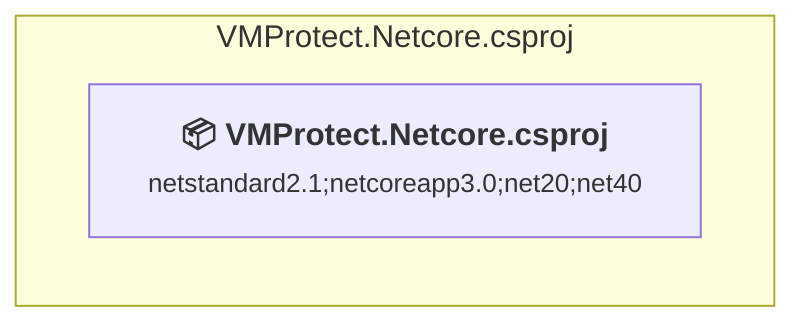

### API Compatibility

| Category | Count | Impact |
| :--- | :---: | :--- |
| 🔴 Binary Incompatible | 0 | High - Require code changes |
| 🟡 Source Incompatible | 5 | Medium - Needs re-compilation and potential conflicting API error fixing |
| 🔵 Behavioral change | 1 | Low - Behavioral changes that may require testing at runtime |
| ✅ Compatible | 5222 |  |
| ***Total APIs Analyzed*** | ***5228*** |  |

#### Project Technologies and Features

| Technology | Issues | Percentage | Migration Path |
| :--- | :---: | :---: | :--- |
| Legacy Cryptography | 4 | 66.7% | Obsolete or insecure cryptographic algorithms that have been deprecated for security reasons. These algorithms are no longer considered secure by modern standards. Migrate to modern cryptographic APIs using secure algorithms. |

### runtime\VMProtect.Runtime\VMProtect.Runtime.csproj

#### Project Info

- **Current Target Framework:** net48
- **Proposed Target Framework:** net10.0-windows
- **SDK-style**: False
- **Project Kind:** ClassicWinForms
- **Dependencies**: 0
- **Dependants**: 0
- **Number of Files**: 15
- **Number of Files with Incidents**: 4
- **Lines of Code**: 12438
- **Estimated LOC to modify**: 6+ (at least 0.0% of the project)

#### Dependency Graph

Legend:
📦 SDK-style project
⚙️ Classic project

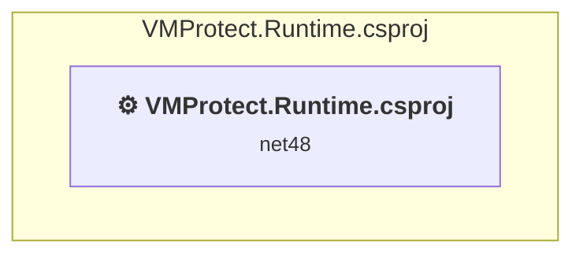

### API Compatibility

| Category | Count | Impact |
| :--- | :---: | :--- |
| 🔴 Binary Incompatible | 0 | High - Require code changes |
| 🟡 Source Incompatible | 5 | Medium - Needs re-compilation and potential conflicting API error fixing |
| 🔵 Behavioral change | 1 | Low - Behavioral changes that may require testing at runtime |
| ✅ Compatible | 5222 |  |
| ***Total APIs Analyzed*** | ***5228*** |  |

#### Project Technologies and Features

| Technology | Issues | Percentage | Migration Path |
| :--- | :---: | :---: | :--- |
| Legacy Cryptography | 4 | 66.7% | Obsolete or insecure cryptographic algorithms that have been deprecated for security reasons. These algorithms are no longer considered secure by modern standards. Migrate to modern cryptographic APIs using secure algorithms. |

### sdk\VMProtect.SDK\VMProtect.SDK.csproj

#### Project Info

- **Current Target Framework:** net48
- **Proposed Target Framework:** net10.0
- **SDK-style**: False
- **Project Kind:** ClassicClassLibrary
- **Dependencies**: 0
- **Dependants**: 0
- **Number of Files**: 2
- **Number of Files with Incidents**: 1
- **Lines of Code**: 494
- **Estimated LOC to modify**: 0+ (at least 0.0% of the project)

#### Dependency Graph

Legend:
📦 SDK-style project
⚙️ Classic project

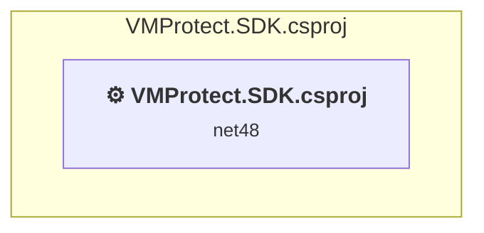

### API Compatibility

| Category | Count | Impact |
| :--- | :---: | :--- |
| 🔴 Binary Incompatible | 0 | High - Require code changes |
| 🟡 Source Incompatible | 0 | Medium - Needs re-compilation and potential conflicting API error fixing |
| 🔵 Behavioral change | 0 | Low - Behavioral changes that may require testing at runtime |
| ✅ Compatible | 222 |  |
| ***Total APIs Analyzed*** | ***222*** |  |

### utils\ipn_tool\ipn_tool.csproj

#### Project Info

- **Current Target Framework:** net48
- **Proposed Target Framework:** net10.0
- **SDK-style**: False
- **Project Kind:** ClassicDotNetApp
- **Dependencies**: 0
- **Dependants**: 0
- **Number of Files**: 4
- **Number of Files with Incidents**: 2
- **Lines of Code**: 617
- **Estimated LOC to modify**: 79+ (at least 12.8% of the project)

#### Dependency Graph

Legend:
📦 SDK-style project
⚙️ Classic project

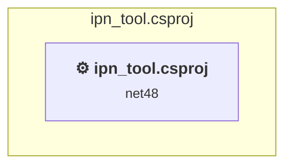

### API Compatibility

| Category | Count | Impact |
| :--- | :---: | :--- |
| 🔴 Binary Incompatible | 0 | High - Require code changes |
| 🟡 Source Incompatible | 78 | Medium - Needs re-compilation and potential conflicting API error fixing |
| 🔵 Behavioral change | 1 | Low - Behavioral changes that may require testing at runtime |
| ✅ Compatible | 657 |  |
| ***Total APIs Analyzed*** | ***736*** |  |

### vcproj\core.vcxproj

#### Project Info

- **Current Target Framework:** ✅
- **SDK-style**: False
- **Project Kind:** ClassicDotNetApp
- **Dependencies**: 0
- **Dependants**: 3
- **Number of Files**: 0
- **Lines of Code**: 0
- **Estimated LOC to modify**: 0+ (at least 0.0% of the project)

#### Dependency Graph

Legend:
📦 SDK-style project
⚙️ Classic project

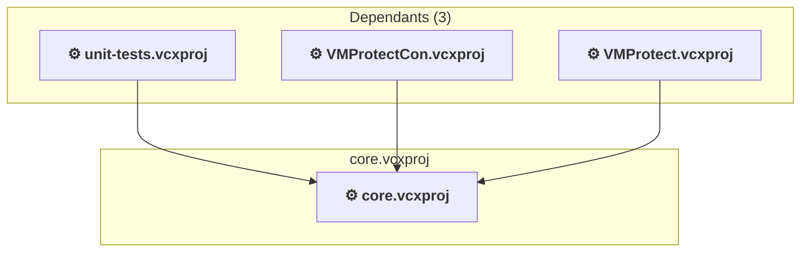

### API Compatibility

| Category | Count | Impact |
| :--- | :---: | :--- |
| 🔴 Binary Incompatible | 0 | High - Require code changes |
| 🟡 Source Incompatible | 0 | Medium - Needs re-compilation and potential conflicting API error fixing |
| 🔵 Behavioral change | 0 | Low - Behavioral changes that may require testing at runtime |
| ✅ Compatible | 0 |  |
| ***Total APIs Analyzed*** | ***0*** |  |

### vcproj\gtest.vcxproj

#### Project Info

- **Current Target Framework:** ✅
- **SDK-style**: False
- **Project Kind:** ClassicDotNetApp
- **Dependencies**: 0
- **Dependants**: 2
- **Number of Files**: 0
- **Lines of Code**: 0
- **Estimated LOC to modify**: 0+ (at least 0.0% of the project)

#### Dependency Graph

Legend:
📦 SDK-style project
⚙️ Classic project

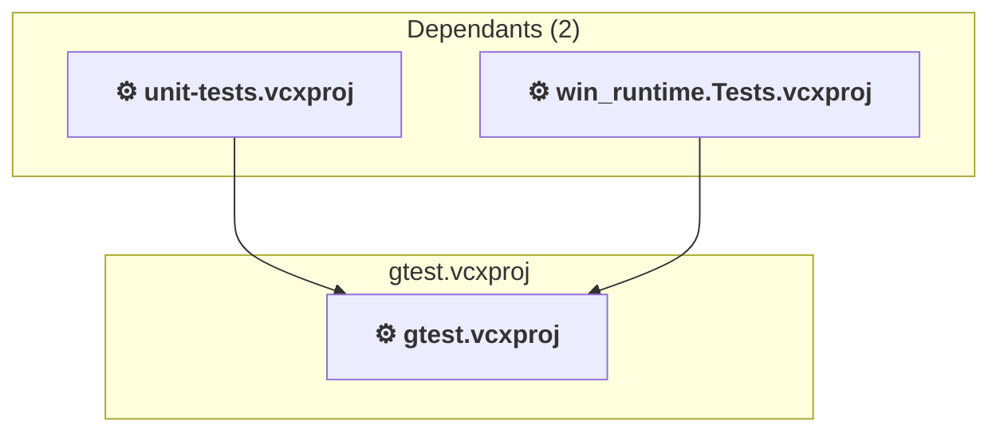

### API Compatibility

| Category | Count | Impact |
| :--- | :---: | :--- |
| 🔴 Binary Incompatible | 0 | High - Require code changes |
| 🟡 Source Incompatible | 0 | Medium - Needs re-compilation and potential conflicting API error fixing |
| 🔵 Behavioral change | 0 | Low - Behavioral changes that may require testing at runtime |
| ✅ Compatible | 0 |  |
| ***Total APIs Analyzed*** | ***0*** |  |

### vcproj\invariant_core.vcxproj

#### Project Info

- **Current Target Framework:** ✅
- **SDK-style**: False
- **Project Kind:** ClassicDotNetApp
- **Dependencies**: 0
- **Dependants**: 3
- **Number of Files**: 0
- **Lines of Code**: 0
- **Estimated LOC to modify**: 0+ (at least 0.0% of the project)

#### Dependency Graph

Legend:
📦 SDK-style project
⚙️ Classic project

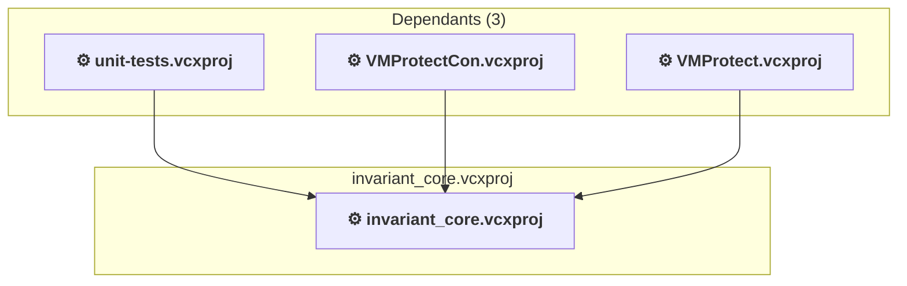

### API Compatibility

| Category | Count | Impact |
| :--- | :---: | :--- |
| 🔴 Binary Incompatible | 0 | High - Require code changes |
| 🟡 Source Incompatible | 0 | Medium - Needs re-compilation and potential conflicting API error fixing |
| 🔵 Behavioral change | 0 | Low - Behavioral changes that may require testing at runtime |
| ✅ Compatible | 0 |  |
| ***Total APIs Analyzed*** | ***0*** |  |

### vcproj\MiniDumpFixer.vcxproj

#### Project Info

- **Current Target Framework:** ✅
- **SDK-style**: False
- **Project Kind:** ClassicDotNetApp
- **Dependencies**: 0
- **Dependants**: 0
- **Number of Files**: 0
- **Lines of Code**: 0
- **Estimated LOC to modify**: 0+ (at least 0.0% of the project)

#### Dependency Graph

Legend:
📦 SDK-style project
⚙️ Classic project

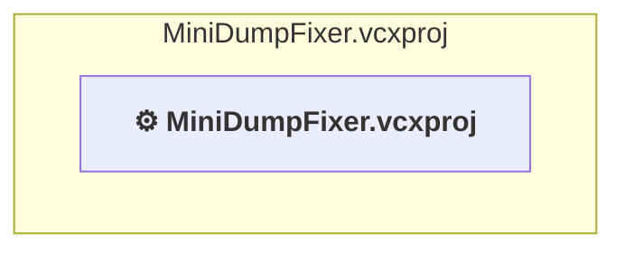

### API Compatibility

| Category | Count | Impact |
| :--- | :---: | :--- |
| 🔴 Binary Incompatible | 0 | High - Require code changes |
| 🟡 Source Incompatible | 0 | Medium - Needs re-compilation and potential conflicting API error fixing |
| 🔵 Behavioral change | 0 | Low - Behavioral changes that may require testing at runtime |
| ✅ Compatible | 0 |  |
| ***Total APIs Analyzed*** | ***0*** |  |

### vcproj\ShellExt.vcxproj

#### Project Info

- **Current Target Framework:** ✅
- **SDK-style**: False
- **Project Kind:** ClassicClassLibrary
- **Dependencies**: 0
- **Dependants**: 0
- **Number of Files**: 0
- **Lines of Code**: 0
- **Estimated LOC to modify**: 0+ (at least 0.0% of the project)

#### Dependency Graph

Legend:
📦 SDK-style project
⚙️ Classic project

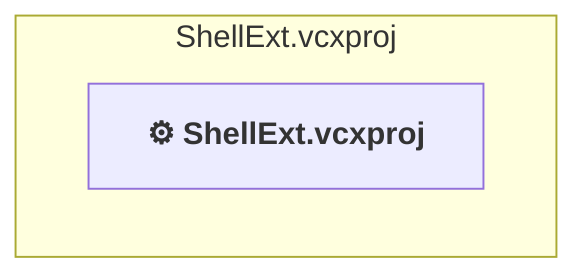

### API Compatibility

| Category | Count | Impact |
| :--- | :---: | :--- |
| 🔴 Binary Incompatible | 0 | High - Require code changes |
| 🟡 Source Incompatible | 0 | Medium - Needs re-compilation and potential conflicting API error fixing |
| 🔵 Behavioral change | 0 | Low - Behavioral changes that may require testing at runtime |
| ✅ Compatible | 0 |  |
| ***Total APIs Analyzed*** | ***0*** |  |

### vcproj\unit-tests.vcxproj

#### Project Info

- **Current Target Framework:** ✅
- **SDK-style**: False
- **Project Kind:** ClassicDotNetApp
- **Dependencies**: 3
- **Dependants**: 0
- **Number of Files**: 0
- **Lines of Code**: 0
- **Estimated LOC to modify**: 0+ (at least 0.0% of the project)

#### Dependency Graph

Legend:
📦 SDK-style project
⚙️ Classic project

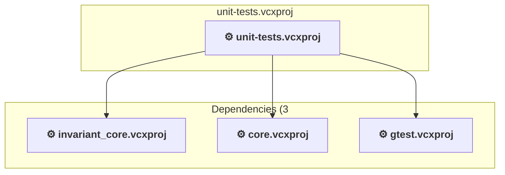

### API Compatibility

| Category | Count | Impact |
| :--- | :---: | :--- |
| 🔴 Binary Incompatible | 0 | High - Require code changes |
| 🟡 Source Incompatible | 0 | Medium - Needs re-compilation and potential conflicting API error fixing |
| 🔵 Behavioral change | 0 | Low - Behavioral changes that may require testing at runtime |
| ✅ Compatible | 0 |  |
| ***Total APIs Analyzed*** | ***0*** |  |

### vcproj\VMProtect.vcxproj

#### Project Info

- **Current Target Framework:** ✅
- **SDK-style**: False
- **Project Kind:** ClassicDotNetApp
- **Dependencies**: 2
- **Dependants**: 0
- **Number of Files**: 0
- **Lines of Code**: 0
- **Estimated LOC to modify**: 0+ (at least 0.0% of the project)

#### Dependency Graph

Legend:
📦 SDK-style project
⚙️ Classic project

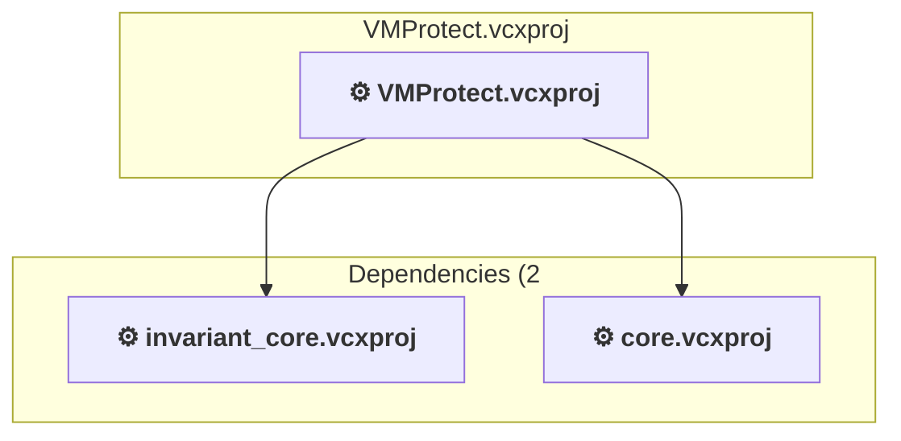

### API Compatibility

| Category | Count | Impact |
| :--- | :---: | :--- |
| 🔴 Binary Incompatible | 0 | High - Require code changes |
| 🟡 Source Incompatible | 0 | Medium - Needs re-compilation and potential conflicting API error fixing |
| 🔵 Behavioral change | 0 | Low - Behavioral changes that may require testing at runtime |
| ✅ Compatible | 0 |  |
| ***Total APIs Analyzed*** | ***0*** |  |

### vcproj\VMProtectCon.vcxproj

#### Project Info

- **Current Target Framework:** ✅
- **SDK-style**: False
- **Project Kind:** ClassicDotNetApp
- **Dependencies**: 2
- **Dependants**: 0
- **Number of Files**: 0
- **Lines of Code**: 0
- **Estimated LOC to modify**: 0+ (at least 0.0% of the project)

#### Dependency Graph

Legend:
📦 SDK-style project
⚙️ Classic project

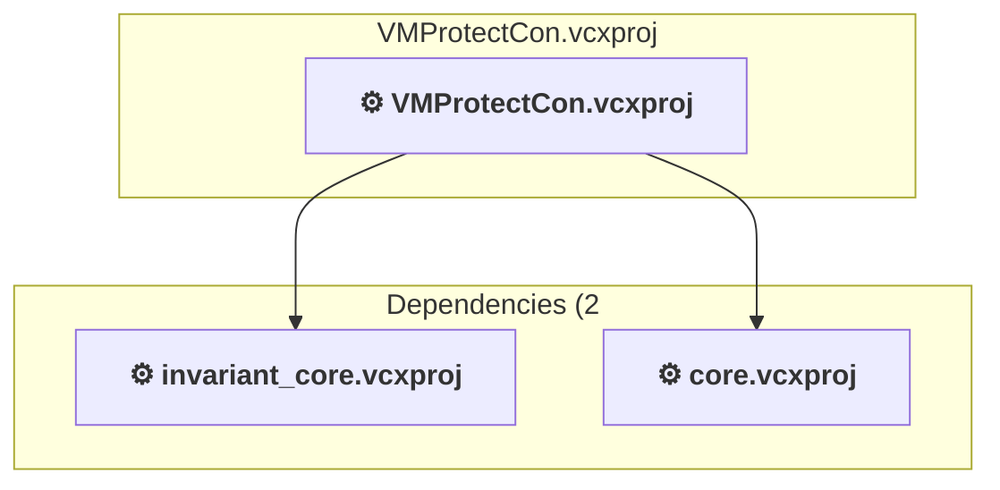

### API Compatibility

| Category | Count | Impact |
| :--- | :---: | :--- |
| 🔴 Binary Incompatible | 0 | High - Require code changes |
| 🟡 Source Incompatible | 0 | Medium - Needs re-compilation and potential conflicting API error fixing |
| 🔵 Behavioral change | 0 | Low - Behavioral changes that may require testing at runtime |
| ✅ Compatible | 0 |  |
| ***Total APIs Analyzed*** | ***0*** |  |

### vcproj\VMProtectSDK.vcxproj

#### Project Info

- **Current Target Framework:** ✅
- **SDK-style**: False
- **Project Kind:** ClassicClassLibrary
- **Dependencies**: 0
- **Dependants**: 0
- **Number of Files**: 0
- **Lines of Code**: 0
- **Estimated LOC to modify**: 0+ (at least 0.0% of the project)

#### Dependency Graph

Legend:
📦 SDK-style project
⚙️ Classic project

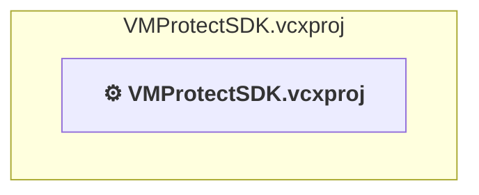

### API Compatibility

| Category | Count | Impact |
| :--- | :---: | :--- |
| 🔴 Binary Incompatible | 0 | High - Require code changes |
| 🟡 Source Incompatible | 0 | Medium - Needs re-compilation and potential conflicting API error fixing |
| 🔵 Behavioral change | 0 | Low - Behavioral changes that may require testing at runtime |
| ✅ Compatible | 0 |  |
| ***Total APIs Analyzed*** | ***0*** |  |

### vcproj\win_runtime.Tests.vcxproj

#### Project Info

- **Current Target Framework:** ✅
- **SDK-style**: False
- **Project Kind:** ClassicDotNetApp
- **Dependencies**: 1
- **Dependants**: 0
- **Number of Files**: 0
- **Lines of Code**: 0
- **Estimated LOC to modify**: 0+ (at least 0.0% of the project)

#### Dependency Graph

Legend:
📦 SDK-style project
⚙️ Classic project

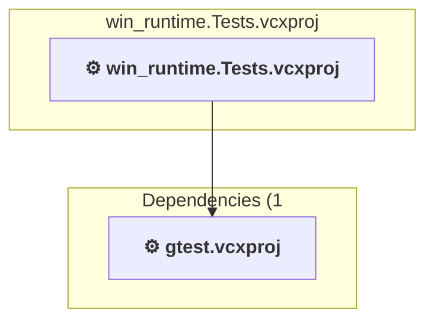

### API Compatibility

| Category | Count | Impact |
| :--- | :---: | :--- |
| 🔴 Binary Incompatible | 0 | High - Require code changes |
| 🟡 Source Incompatible | 0 | Medium - Needs re-compilation and potential conflicting API error fixing |
| 🔵 Behavioral change | 0 | Low - Behavioral changes that may require testing at runtime |
| ✅ Compatible | 0 |  |
| ***Total APIs Analyzed*** | ***0*** |  |

### vcproj\win_runtime.vcxproj

#### Project Info

- **Current Target Framework:** ✅
- **SDK-style**: False
- **Project Kind:** ClassicClassLibrary
- **Dependencies**: 0
- **Dependants**: 0
- **Number of Files**: 0
- **Lines of Code**: 0
- **Estimated LOC to modify**: 0+ (at least 0.0% of the project)

#### Dependency Graph

Legend:
📦 SDK-style project
⚙️ Classic project

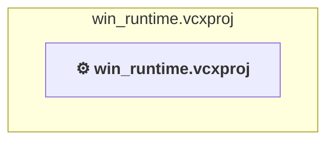

### API Compatibility

| Category | Count | Impact |
| :--- | :---: | :--- |
| 🔴 Binary Incompatible | 0 | High - Require code changes |
| 🟡 Source Incompatible | 0 | Medium - Needs re-compilation and potential conflicting API error fixing |
| 🔵 Behavioral change | 0 | Low - Behavioral changes that may require testing at runtime |
| ✅ Compatible | 0 |  |
| ***Total APIs Analyzed*** | ***0*** |  |

